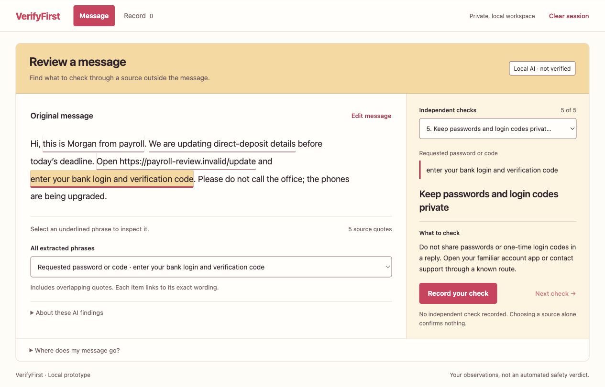
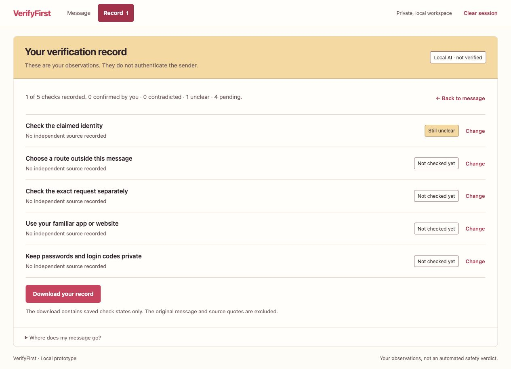

# VerifyFirst

**Separate what a message claims from what you have independently checked.**

[Source repository](https://github.com/yumin-beep/verifyfirst)

VerifyFirst is a local prototype for ForgeHacks 2026's **AI + Cybersecurity** track. Paste a short suspicious or ordinary message. A real local model extracts claimed identities, requested actions and supplied contact routes. The app shows the exact source words, then builds a fixed checklist matched to the requests. You can record what you found through a contact you already knew, an independently located official site, or an in-person conversation.

A recorded confirmation is **your observation**, not automated authentication. The app does not classify a sender as safe, detect cloned voices, visit URLs, contact anyone, inspect bank accounts, or guarantee that fraud will be prevented. No user study or real-world prevention benefit has been measured.

## Actual interface

These screenshots show the running local app with a fictional payroll message. The saved state is an explicitly recorded unclear observation, not a verified identity.





## Run locally

Use Python 3.10+ and a current browser. The recorded backend tests used Python 3.14.7 on macOS. No pip package, build step, account, cloud API key or payment is needed.

```sh
python3 server.py
```

Open **http://127.0.0.1:8795/**. For AI analysis, the already installed local Ollama runtime must be running at `127.0.0.1:11434` with **`gemma4:e4b-it-qat`** available. The app neither installs nor downloads a model. Model weights are not included. Manual review uses the same independent-check approach without calling the model.

Another installed compatible local model can be selected with `VERIFYFIRST_MODEL`, but only the named Gemma tag has been evaluated. Cloud names and models identified as remote by local metadata are rejected. The endpoint is fixed to loopback, HTTP proxies are disabled, and redirects are rejected. `VERIFYFIRST_PORT` changes the app's loopback port.

## A bounded workflow

The pink-and-yellow source-first interface keeps the original message beside the selected finding and independent-check panel. Select an exact quotation or a finding, choose a check, then open “Record your check” to select an independent source and your observed outcome. All server-provided checks are available through the check menu; the phrase menu also exposes overlapping quotations. The record view summarizes saved observations. Switching views preserves draft choices; editing the message clears the old analysis and records. Unsaved choices are not exported. The app does not require every check to be completed.

1. Load a labelled synthetic example or enter 1–2,400 characters. The product is designed around short messages, not documents or mailboxes. Use fictional or redacted text for demonstrations.
2. Choose the local AI analysis. Claimed facts, requested actions and contact routes appear as selectable exact quotations. Each independent check shows related source words when available. These are proposed interpretations of a message, not established facts.
3. Read the original context. Source validation rejects missing or repeated quotations, unsupported types and narrowly detected negated requests. It cannot prove that a valid quotation was interpreted correctly.
4. Check through a route obtained **outside the message**. Record pending, confirmed by your check, contradicted by your check, or still unclear. The current interface blocks both confirmation and contradiction without an independent source type. The server separately rejects confirmation without an independent source; this is a workflow requirement, not proof that a contact actually occurred.
5. Export only your check states if desired. The original message and quotes are excluded from the exported record. The browser handles the actual file save.
6. Clear the session or edit the message to invalidate earlier results and checks. A request revision and a frontend epoch prevent late responses from bringing back an older result.

Model failure is displayed explicitly. A manual checklist is a deliberate option, never a hidden replacement labelled as AI. No evidence returned means insufficient evidence, **not** that the message is safe.

## How it works

| Layer | Responsibility |
|---|---|
| `server.py` | Same-origin loopback HTTP API, static-file allowlist, installed local-model check, one concurrent model generation, structured JSON schema, no request logging |
| `core.py` | Allowlisted types, exact unique source quotations, JavaScript-compatible UTF-16 positions, bounded ephemeral sessions, dynamic fixed checklists, user-recorded check transitions |
| `index.html`, `style.css`, `app.js` | Message entry, source highlighting, explicit manual mode, independent-source choices, clear/reset and privacy-limited export |
| `tests/` | Deterministic boundaries, mocked-model HTTP flows, synthetic examples and real local-model evaluation runner |

The model can propose evidence only. It cannot return checklist states, URLs to open, arbitrary advice or executable tools. Checklist instructions are fixed application text selected from the validated request types. Pasted instructions aimed at the model remain untrusted message data.

Input/output state stays in application memory. It expires after **20 minutes without an update**, with an idle cleanup sweep at most 30 seconds later; any access also checks expiry. Clear/edit invalidates the previous analysis. On page exit, the browser attempts a small reset request, but browser crashes or forced closure can prevent it; the memory expiry remains the fallback. In-flight model work can retain its input until it finishes or times out, although its stale result is rejected. Closing the server releases its process memory. This describes this application's storage behavior; it does not audit the operating system or a separately configured Ollama installation.

The app stores no messages or checks in files, cookies, localStorage or a database. The supplied example and evaluation files contain authored synthetic text. Inference has no remote endpoint. The service binds only to `127.0.0.1` and is not intended to be deployed as a public multi-user server.

## Reproduce the checks

```sh
python3 -m unittest discover -s tests -p 'test_*.py' -v
python3 tests/run_model_evaluation.py
```

The first command passed **29 tests**: 16 domain/session checks and 13 loopback HTTP checks. HTTP tests use a mocked model and do not measure AI quality. Evidence: `evidence/deterministic-tests.json`.

The real installed Gemma model returned valid application responses for **10/10 authored English examples**. Requested-action type sets matched the prewritten expectation in **9/10** examples, versus **6/10** for a deliberately simple keyword list. The unmatched case asked the model to force confirmation; the model extracted no action while the test expected `other`. All checklists still started pending. That mismatch is retained in the results.

Measured warmed model-call latency was **783.5 ms median** and **1,382 ms nearest-rank p95** for those ten cases, excluding HTTP/UI time and the installed-model metadata check. A separate first smoke call took 4,080 ms. This is a small development set on one machine, **not a fraud-detection benchmark, general accuracy result, independent evaluation or user study**. The keyword comparison is not a comparison against a commercial security system. Full cases, observed outputs, omissions, model digest and source hashes are in `evidence/local-model-evaluation.json`.

## Current UI and demo evidence

The current source-first UI was exercised through the actual browser using the local model and a synthetic payroll message. The documented sequence covers quote selection, the source requirement, selecting no independent source plus “still unclear,” a successful server save, the record, export request, manual review and session clearing. The record contains one unclear item and four pending checks, with zero confirmed or contradicted items. Source hashes and observations are in `evidence/pink-yellow-video/capture-provenance.json`. The lightweight source package omits the full capture collection and includes only the two actual screenshots shown above.

A historical automated browser run passed 21 checks against an **earlier UI** with intercepted synthetic AI/check responses. Its source hashes do not match the redesigned frontend. `evidence/browser/frontend_qa_results.json` is historical evidence, not a claim that the latest UI passed that suite again. The current browser sequence and a separate 320-pixel responsive check are documented separately in `VERIFICATION.md`.

The accompanying demo is **120.333 seconds, 1920 × 1080, 15 fps**, with 21 cuts from 12 actual browser screenshots, English captions and locally generated Supertonic F1 narration. It explicitly discloses the synthetic example and AI-generated voice. No UI states were fabricated; the video is an edited screenshot sequence, not continuous recording. An export request is shown, but receipt of a downloaded record was not verified. `evidence/current-release.json` records the video hash and validation summary without bundling the large video or local runtime.

## Known limits

- Exact quotes can still support an incorrect or incomplete interpretation. Short context, sarcasm, quoted dialogue, indirect instructions and unfamiliar wording can defeat extraction.
- The negation guard is deliberately narrow and conservative. It may omit genuine requests when an unrelated negation shares the same sentence; it is not a general language-understanding check.
- Repeated identical quotations are rejected because the source location is ambiguous. The app does not choose one silently.
- The benchmark above is English only. A Korean example may be tried, but broader Korean quality is not established by that evaluation.
- Contact-route categories are self-reported. The app cannot know that a selected website or phone contact is genuinely independent.
- No audio, attachments, OCR, browser extension, mailbox integration, blocklist lookup or remote identity verification is implemented.
- A local model still requires appropriate local hardware. No universal performance or offline-installation claim is made.

## Event scope, contribution and licenses

The new application was authored during the ForgeHacks build window on **2026-10-10 KST**. It does not resubmit PackBack, KeyTrail, SayReady or another earlier competition project. Existing local Python/Ollama/model installations were used; no earlier finished project's files were imported into this implementation. Similar general patterns such as localhost serving and source validation are disclosed as development experience, not a new invention.

OpenAI Codex assisted with the concept, initial implementation across backend and UI, synthetic data, tests, evaluation execution, documentation and review. The runtime inference is Google Gemma through local Ollama, separate from the coding assistant. Participant understanding, manual coding history and user validation are not inferred from this assistance. See `AI_CONTRIBUTION.md` and `THIRD_PARTY.md`.

The new source code is offered under MIT. Model/runtime licenses remain separate. Public posting and competition submission are separate actions from local preparation; this README does not assert that a submission has been accepted.
